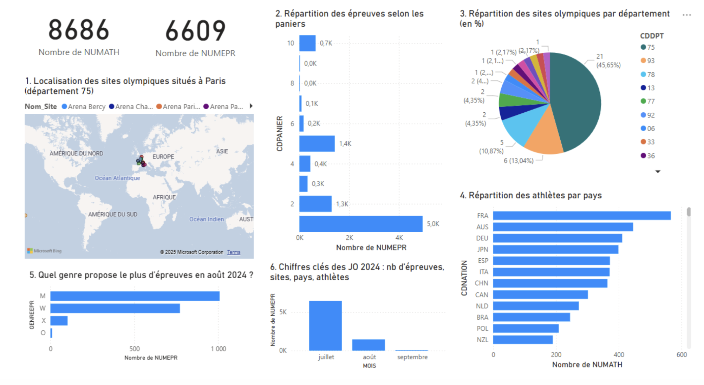

# Paris 2024 Olympic Games: SQL Database and Power BI Analysis

Pair project (BUT Computer Science, Data track, IUT of Reims, 2025): design, build and query a relational database about the Paris 2024 Olympic Games, then analyze it with an interactive Power BI dashboard.

The work goes from conceptual modeling to a populated Oracle database, 17 documented queries, access rights management and a visual analysis of the Games.

**Stack:** Oracle SQL (SQL Developer), data modeling (conceptual data model), Power BI.

## Team

Project of 2 students: Moughamir and Bhagat. The work was shared between the two of us, and the access rights section was tested across our two accounts.

## Part 1: modeling and database creation

- **Conceptual model:** entity-relationship model of the Games (sites, site types, departments, disciplines, events, event phases, athletes, participations, ticket purchases), delivered as a model file and a PDF.
- **Schema creation:** SQL scripts that create the tables with primary keys, foreign keys, NOT NULL constraints and a domain constraint, plus indexes on foreign keys and on searched columns (site names, athlete names, event names).
- **Computed column:** a virtual column that derives the duration of an event.
- **Data quality and integrity:** linking a table of people to a table of countries. Country names were reconciled between the two sources, a country code column was added and filled, the old text column was dropped and a foreign key was created. A deletion test shows the referential integrity at work.
- **Analytical queries:** 7 queries on people and countries, for example number of countries represented, people per region, countries above a threshold, the oldest person per country, and filters on country names.

## Part 2: data loading, queries and analysis

- **Loading:** reference tables inserted by script, sites imported from CSV, disciplines, athletes, events and participations loaded from a staging schema with filtering of incomplete rows, and a table linking disciplines to sites.
- **Test data:** a set of fictional spectators and ticket purchases to exercise the model (purchases in Paris, outside Paris, in arenas, at a given site).
- **10 queries**, including several ways to answer the same question to compare approaches: joins, subqueries, `NOT EXISTS`, `LEFT JOIN ... IS NULL` and `IN`. Other queries use aggregates (`SUM`, `AVG`, `COUNT`), outer joins, multi-column grouping and a relational division with `MINUS` (spectators who bought a ticket for every event of a given site).
- **Rights management:** `GRANT` on tables, restricted access through a view, and update and delete operations executed from the partner account to check privileges.
- **Power BI dashboard:** a one-page report with KPI cards, a map of the sites, bar charts and a pie chart, summarized in a two-page PDF.

## Dashboard preview



## Key figures from the analysis

- 8,686 athletes and 6,609 events in the dataset.
- About 46% of the sites are in Paris, followed by Seine-Saint-Denis with about 13%.
- France is the best represented country among athletes in the dataset, ahead of Australia and Germany.
- July concentrates most of the events, far ahead of August and September.
- In August 2024, men's events are the most numerous, ahead of women's and mixed events.

## Repository content

```
powerbi-dashboard.png                       dashboard screenshot used in this README
SAE_MS204_Partie1_Moughamir_Bhagat/
  JO_MCD_BHAGAT_MOUGHAMIR.mcd / .pdf        conceptual data model
  JO_Partie1_1_Moughamir_Bhagat.sql         people and countries, integrity, 7 queries
  JO_Partie1_2_3_BHAGAT_MOUGHAMIR.sql       schema creation, constraints, indexes
SAE_MS204_Partie2_Moughamir_Bhagat/
  JO_Partie2_Moughamir_Bhagat.sql           loading, queries, rights management
  JO_Partie2_Bhagat_Moughamir.pbix          Power BI report
  JO_Partie2_Bhagat_Moughamir.pdf           summary of the analysis
```

## Notes

- The scripts target Oracle. The source data comes from a staging schema provided by the school, which is not included in this repository, so the loading scripts cannot be replayed as they are.
- The ticket purchases and spectators are fictional test data created for the exercise.

## Author

Khalil Moughamir
- Portfolio: [khalil-moughamir.vercel.app](https://khalil-moughamir.vercel.app)
- LinkedIn: [linkedin.com/in/khalil-moughamir](https://www.linkedin.com/in/khalil-moughamir)
